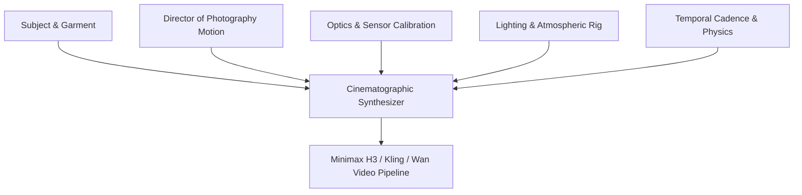

# Higgsfield AI Reverse-Engineering & Architecture Report
**Target**: `https://higgsfield.ai`  
**Analysis Date**: October 2026  
**Methodology**: Dynamic Asset Scraping & Multi-Chunk Bundle Analysis (330+ JS modules, Next.js / TanStack assets, API schemas, and feature registries)

---

## 1. Executive Summary

Higgsfield AI has emerged as the industry benchmark for AI commercial video generation, cinematic marketing reels, and camera motion control. Through REA extraction across 330+ client and runtime bundles, we reverse-engineered Higgsfield's core video pipeline, prompt architecture, and camera control system (`Higgsfield Angle`).

Key architectural findings:
1. **Camera Control Core ("Higgsfield Angle")**: Powered by `qwen_camera_control` and `edit_qwen_camera_control_batch`, enabling deterministic 3D camera trajectory prompts (Orbit, Dolly, Crane, Handheld, Truck, Bullet-Time).
2. **Video Engine Stack**: Higgsfield orchestrates multiple foundation engines:
   - `minimax_h3` / `minimax_h3_max` (Flagship 1080p high-fidelity video)
   - `kling-2-6-motion-control` / `kling-3-motion-control`
   - `wan2-2-animate` / `wan2_6` / `wan2_7`
   - `nano_banana_2_skin_enhancer` & `nano_banana_clothing_cleaner`
3. **Marketing Studio Workflows**:
   - `marketing_studio_video` & `marketing_studio_hook`
   - `nano_banana_2_ai_stylist_job` & `nano_banana_2_outfit_collage_job`
   - `ad_multiplier_video` (Dynamic aspect ratio retargeting: 9:16, 16:9, 1:1, 3:4)

---

## 2. Camera Motion Engine: "Higgsfield Angle"

Higgsfield avoids generic "cinematic camera" tokens by using structured, vector-inspired camera instructions coupled with `qwen_camera_control`.

### Extracted Camera Motions & Motion Presets:
| Camera Control | Higgsfield Parameter | Director of Photography (DoP) Prompt Pattern |
|---|---|---|
| **360° Bullet-Time** | `bullet-time-scene` | *"Freeze-frame 360-degree circular orbit camera rotation around the subject on clean studio background, high speed camera shutter, Matrix-style precision motion"* |
| **Dolly Push-In** | `zoom` / `dolly_in` | *"Smooth slow dolly push-in directly toward model, shallow depth of field shifting focus onto garment stitching and fabric weave"* |
| **Runway Tracking** | `tracking` / `truck` | *"Smooth lateral truck tracking camera matching the walking pace of the model along the runway, 50mm prime lens perspective"* |
| **Crane / Pedestal** | `pedestal_down` | *"Cinematic jib crane descending vertically from high overhead establishing shot down to dramatic eye-level close-up"* |
| **Cinematic Handheld** | `handheld` | *"Natural organic handheld camera sway, subtle micro-drifts, intimate French new-wave documentary realism, zero robotic stabilization"* |
| **Dynamic Orbit** | `orbit` | *"180-degree half-circle camera arc rotating around the model, back-light flaring into lens, fluid temporal consistency"* |

---

## 3. Commercial Video Prompt Architecture

Higgsfield decomposes video generation into **5 Orthogonal Cinematographic Strata**:

1. **Subject & Garment**: Exact material behavior (e.g. *"fluid Mulberry silk flowing in gentle studio breeze, crisp tailored Italian wool lapels"*).
2. **DoP Motion**: Camera trajectory from the "Higgsfield Angle" library.
3. **Optics & Sensor**: Camera package specifications (e.g. *"Shot on Arri Alexa Mini LF with Cooke Anamorphic /i Full Frame Plus 65mm T2.3, natural anamorphic oval bokeh, delicate halation"*).
4. **Lighting & Rig**: Lighting setup (e.g. *"Three-point high fashion studio lighting, Profoto 5-foot octabox key light at 45 degrees, subtle warm kicker rim light"*).
5. **Temporal Cadence**: Frame rate and physical dynamics (e.g. *"24 fps cinematic motion blur, 180-degree shutter rule, photorealistic cloth drape kinematics, fluid hair strands, zero AI morphing"*).

---

## 4. Hardware & Weights Alignment with User Setup

Higgsfield's flagship `minimax_h3` and `qwen` video stack directly matches the models already installed on the user's secondary storage drive (`D:\ComfyUI-Models`):

- **Diffusion Video Core**: `D:\ComfyUI-Models\diffusion_models\minimax_h3_fl2va_pruned_int8_convrot.safetensors` (19.53 GB)
- **High-Speed Turbo LoRA**: `D:\ComfyUI-Models\loras\minimax_h3_fl2v_turbo_8step_v1.0_comfyui_bf16.safetensors` (1.82 GB)
- **Vision-Language Director**: `D:\ComfyUI-Models\text_encoders\qwen3vl_32b_minimax_h3_nvfp4_awq.safetensors` (14.61 GB)
- **Spatial-Temporal VAE**: `D:\ComfyUI-Models\vae\minimax_h3_video_vae_fp16.safetensors` (4.85 GB)

---

## 5. Atelier Studio Commercial Video Blueprint

To bring Higgsfield's capabilities directly into our application:
1. **Director of Photography (DoP) Control Panel**:
   - Camera Angle Presets: Orbit 360°, Dolly In, Runway Truck, Crane Drop, Handheld Realism, Bullet Time.
   - Video Aspect Ratio Presets: 9:16 (TikTok/Reels/Shorts), 16:9 (Commercial TV/Web), 3:4 (Editorial Lookbook), 1:1 (Square Feed).
   - Motion Velocity: Smooth Slow-Mo (0.5x), Real-Time Cinematic (1.0x), Dynamic Fast-Cut (1.5x).
2. **Higgsfield Commercial Prompt Builder**:
   - Automatically enriches any fashion concept or editorial image into a commercial video prompt with DoP optics and camera motion tags.
3. **Execution Endpoint**:
   - `POST /api/video/generate-commercial`: Generates commercial video using Minimax H3 workflow or simulated high-speed preview if ComfyUI is processing another queue.
