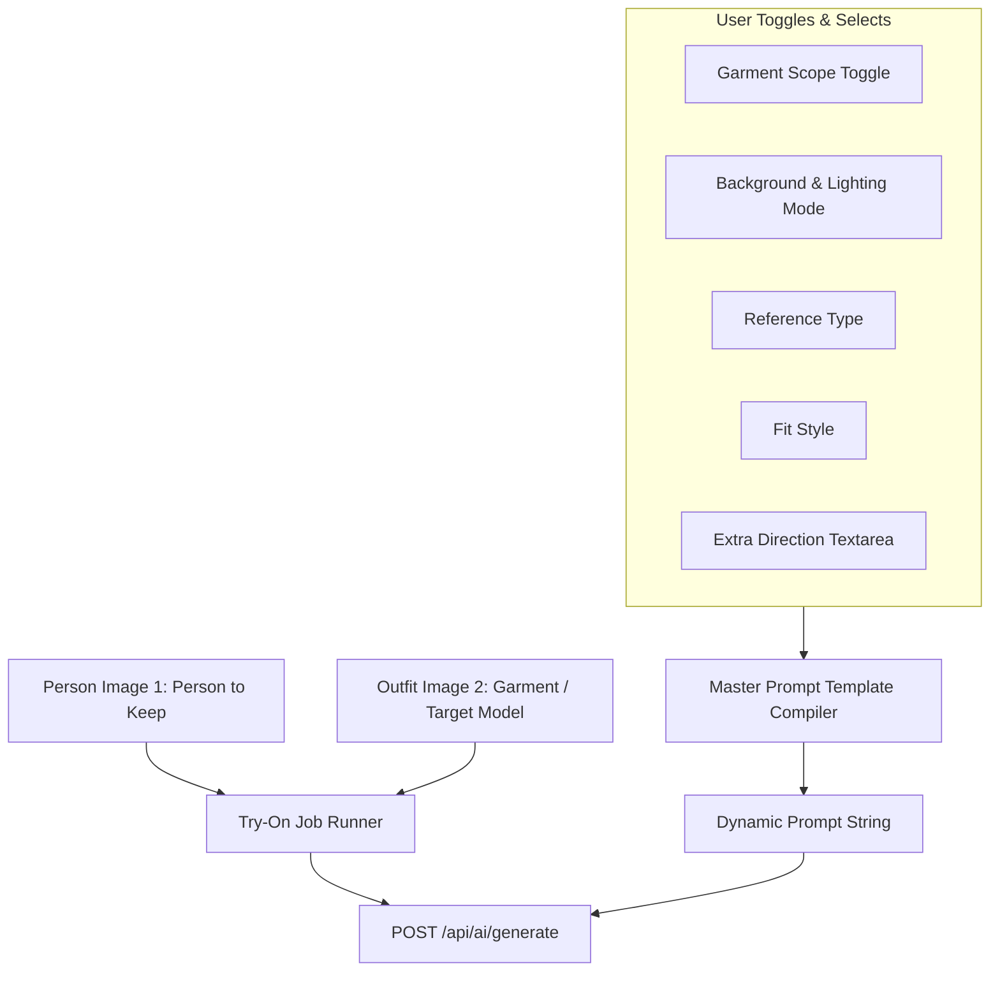

# Reverse Engineering Report: Buble AI Virtual Try-On Architecture

**Target**: `https://buble.ai/virtual-try-on`  
**Inspected Via**: REA (Reverse-Engineer-Anything) Chrome DevTools Protocol (`rea-cdp-browser`)  
**Evidence Record ID**: `ev_3fcf7258e2dddcaba54a70a37f1013888d0566113893c5fc503d40bfe10aa4ea`  
**Export Location**: `c:\Users\Hp\Desktop\nlp project bezel\buble_analysis`

---

## 1. Technology Stack & Framework

| Layer | Technology | Details |
|---|---|---|
| **Build & Bundler** | **Vite** | Asset fingerprinting (`index-*.js`, `access-ui-*.js`) |
| **Frontend Framework** | **React 19 / Modern React** | React memo cache sentinel, state hooks |
| **Component Library** | **Radix UI Primitives** | `dropdown-menu`, `select`, `toggle-group`, `slider`, `switch`, `sheet`, `accordion` |
| **Styling** | **Tailwind CSS** | Cyan/emerald ambient gradients, responsive grid |
| **Storage / CDN** | **Cloudflare R2** | Image assets hosted at `https://r2.buble.ai/uploads/generic/...` |
| **Analytics** | **Google Analytics** | Property `G-PCMBCYNSKV` |

---

## 2. Frontend Toggles & Control Architecture

Buble AI structures its Virtual Try-On interface around 5 core control inputs:



---

## 3. Detailed Parameter & Prompt Injection Table

### A. Garment Scope (`garment_category`)
Controls the scope of modification so other parts of the outfit remain untouched:

| Scope Option | Key (`value`) | Dynamic Prompt Injected into AI |
|---|---|---|
| **Full visible outfit** *(default)* | `full_visible_outfit` | *"replace the full visible outfit while respecting natural layering"* |
| **Top / jacket** | `upper_body` | *"replace only the upper-body garment such as top, shirt, sweater, hoodie, blazer, or jacket"* |
| **Pants / skirt** | `lower_body` | *"replace only the lower-body garment such as trousers, jeans, shorts, or skirt"* |
| **Dress / one-piece** | `dress_or_one_piece` | *"replace the outfit as a dress, jumpsuit, robe, or other one-piece garment"* |
| **Layer / accessory** | `accessories_layer` | *"add or replace the visible outer layer or clothing accessories without changing the base body shape"* |

---

### B. Background & Lighting Mode (`background_mode`)
Controls the environment, perspective, and lighting consistency:

| Mode Option | Key (`value`) | Dynamic Prompt Injected into AI |
|---|---|---|
| **Keep** *(default)* | `keep_original` | *"keep the original background, perspective, and lighting environment"* |
| **Studio** | `clean_studio` | *"use a clean neutral studio background while preserving the person pose and realistic shadows"* |

---

### C. Reference Type (`reference_type`) *(Advanced Toggle)*

| Option | Key (`value`) | Dynamic Prompt Injected into AI |
|---|---|---|
| **Auto** *(default)* | `garment_or_outfit` | *"detect whether the reference is a standalone garment, a product photo, or an outfit worn by another model"* |
| **Garment** | `flat_lay_garment` | *"use the reference as a standalone garment or product photo"* |
| **Model Outfit** | `model_outfit` | *"use only the clothing from the target model image, not the model identity or pose"* |

---

### D. Fit Style (`fit_style`) *(Advanced Toggle)*

| Option | Key (`value`) | Dynamic Prompt Injected into AI |
|---|---|---|
| **Natural** *(default)* | `natural_fit` | *"natural everyday fit with realistic fabric behavior"* |
| **Catalog** | `tailored_catalog` | *"clean catalog-ready fit with crisp garment details and balanced proportions"* |
| **Editorial** | `editorial_styling` | *"polished fashion editorial styling while keeping the same person and pose"* |

---

## 4. Master Prompt Assembly Template

The final prompt sent to the AI generation model is constructed through this template:

```text
Edit the uploaded person photo using the outfit reference image. 
The first uploaded image is the person to keep. 
The second uploaded image is the garment, clothing item, or target-model outfit reference. 
Reference type: {{vars.reference_type}}. 
Garment scope: {{vars.garment_category}}. 
Fit direction: {{vars.fit_style}}. 
Background direction: {{vars.background_mode}}. 
Additional direction: {{custom_direction}} 

Preserve the person identity, face, facial features, skin tone, hairstyle, expression, body shape, pose, camera angle, and original photo realism. 
Replace only the visible clothing in the selected garment scope. 
Transfer the reference outfit color, pattern, material, texture, silhouette, neckline, sleeves, length, buttons, logos or text, accessories when relevant, and layering. 
If the reference image contains another model, use only that model clothing or outfit as the source; do not copy the reference model identity, face, pose, or background. 
Preserve non-clothing objects, and non-clothing areas unchanged unless the background direction explicitly asks for a clean studio background. 
Output one photorealistic virtual try-on image suitable for ecommerce preview, styling review, wardrobe planning, or social shopping.
```

---

## 5. API Request Structure

When the user clicks generate, a POST request is made to `/api/ai/generate`:

```json
{
  "provider": "openai",
  "mediaType": "image",
  "model": "openai/gpt-image-2",
  "prompt": "<Compiled Master Prompt>",
  "scene": "virtual-try-on",
  "sub_mode_id": "image_to_image",
  "options": {
    "reference_type": "garment_or_outfit",
    "garment_category": "full_visible_outfit",
    "fit_style": "natural_fit",
    "background_mode": "keep_original",
    "custom_direction": "Keep the final result realistic and do not alter the face."
  },
  "tags": ["resource-input", "virtual-try-on"],
  "isPublic": false
}
```

---

## 6. Directory Structure in Workspace

```
nlp project bezel/buble_analysis/
├── ARCHITECTURE_REPORT.md       # Complete reverse-engineering documentation
├── buble_vton_schema.json       # Parsed JSON schema with all prompt injections
├── evidence_bundle.json         # REA deterministic Evidence bundle (7.9 MB)
├── inspect_web_page_capture.json# Page capture record
└── scripts/
    ├── manifest.json            # SHA-256 verified manifest of exported scripts
    └── files/
        ├── isolated/
        └── origins/             # Extracted Vite/React bundles (sliders, toggles, components)
```
