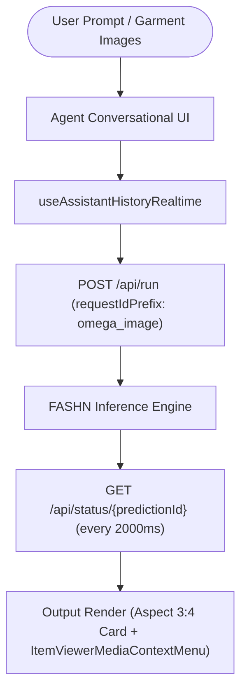

# Reverse Engineering Report: FASHN AI Web & Agent Architecture

**Target**: `https://app.fashn.ai/agent/953ec267-c4f5-45ec-b40f-f42e33c6e1a9`  
**Inspected Via**: REA (Reverse-Engineer-Anything) Chrome DevTools Protocol (`rea-cdp-browser`)  
**Evidence Record ID**: `ev_143811bfdac4878ca342a78d719e6e630b4b5f8d0cfb6335fe70d2dd70acc71d`  
**Export Location**: `c:\Users\Hp\Desktop\nlp project bezel\fashn_analysis`

---

## 1. Technology Stack & Framework

| Layer | Technology | Details |
|---|---|---|
| **Framework** | **Next.js (App Router)** | Built with **Turbopack** (`turbopack-*.js` entry chunks) |
| **Component Library** | **Radix UI / shadcn/ui** | Accessible primitives (`Card`, `Dialog`, `ContextMenu`, `DropdownMenu`) |
| **Styling** | **Tailwind CSS** | Standard utility classes (`aspect-[3/4]`, `ring-primary`, `bg-muted`, `rounded-xl`) |
| **Icons** | **Phosphor / Lucide Icons** | `TShirtIcon`, `UserIcon`, `GhostIcon`, `SwapIcon`, `MagicWandIcon`, `ChatCircleIcon` |
| **State Management** | **React Context & Realtime Hooks** | `useAssistantHistoryRealtime`, `useAgentConnectionMountId` |
| **Polling / Status** | **Short-polling with exponential backoff** | 1000ms–2000ms intervals, 10-minute timeout (`timeout: 6e5`) |

---

## 2. Agent Architecture (`/agent/{agentId}`)

The URL inspected (`/agent/953ec267-c4f5-45ec-b40f-f42e33c6e1a9`) routes to FASHN's **Unified Multi-Modal Agent** called **`omega-image`** and **`omega-video`**:



### Key Message & Part Structure
The agent uses a multipart message structure:
- **`parts`**: Contains text, attachments, and tool invocations.
- **`output`**: Contains `{ predictionId, status: "completed" | "processing", success: true }`.
- **`predictionId`**: Unique job identifier (e.g. `omega_image_xxx` or `tryon_edit_xxx`).

---

## 3. Extracted Tool Schemas & API Payloads

From the extracted JavaScript chunk `1v44ut35pt01e.js`, here are the exact commercial parameter schemas used across all tools:

### A. Try-On (`tryon-edit`)
- **Model Name**: `tryon-edit`
- **Request Prefix**: `tryon_edit`
- **Polling Interval**: `2000ms` | **Timeout**: `600000ms` (10 min)
- **Image Inputs**:
  - `product_image` (Uploader type: `garment`)
  - `model_image` (Uploader type: `model`)
- **Parameters**:
  ```json
  {
    "num_images": 1,
    "aspect_ratio": "default",
    "resolution": "1k",
    "generation_mode": "balanced",
    "prompt": "Optional instructions (e.g. remove scarf, tuck shirt)"
  }
  ```
- **Validation Rule**: Minimum 2 uploaded files (`uploaderFileCount >= 2`).
- **Supports Swap**: `true` (swapping garment between model photos).

### B. Agent Generator (`omega-image`)
- **Model Name**: `omega-image`
- **Request Prefix**: `omega_image`
- **Polling Interval**: `2000ms`
- **Image Inputs**:
  - `images` (Ordered list of input images: garment, model reference, or context)
- **Parameters**:
  ```json
  {
    "aspect_ratio": "default",
    "resolution": "1k",
    "generation_mode": "fast",
    "prompt": "User instruction string",
    "classification": "none"
  }
  ```

### C. Product-to-Model (`product-to-model`)
- **Model Name**: `product-to-model`
- **Purpose**: Converts flat-lay or ghost mannequin photos into realistic on-model shots.
- **Parameters**:
  ```json
  {
    "num_images": 1,
    "aspect_ratio": "default",
    "resolution": "1k",
    "generation_mode": "balanced",
    "face_reference_mode": "auto",
    "prompt": "Model attributes (e.g. Scandinavian, 20s, smiling)"
  }
  ```

### D. Model Swap (`model-swap-edit`)
- **Model Name**: `model-swap-edit`
- **Purpose**: Replaces the person or mannequin while preserving the clothing.
- **Parameters**: `model_image`, `num_images`, `aspect_ratio`, `resolution`, `prompt`.

### E. Packshot (`packshot`)
- **Model Name**: `packshot`
- **Purpose**: Converts on-model or amateur photos into clean studio packshots on isolated backgrounds.

---

## 4. Directory Structure of Exported Files

All exported code and artifacts are located in `fashn_analysis`:

```
nlp project bezel/fashn_analysis/
├── ARCHITECTURE_REPORT.md             # This comprehensive architecture report
├── evidence_bundle.json               # Full REA CDP Evidence bundle (5.2 MB)
├── inspect_web_page_capture.json      # Normalized page inspection capture
├── fashn_tool_schemas.json            # Parsed schemas for all 13 tools
├── analyze.py                         # Analysis script
├── deep_extract.py                    # Deep schema extractor
└── scripts/
    ├── manifest.json                  # SHA-256 verified script manifest
    └── files/
        └── origins/
            └── 6a40b85d.../
                └── _next/static/immutable/chunks/
                    ├── 1v44ut35pt01e.js   # Main tool & model definitions
                    ├── 1oocs9xhva_bw.js   # Model pricing & gallery registry
                    ├── 28t8fdp9h7_vq.js   # Navigation & studio toolbar
                    ├── 3qya1fm-pxh98.js   # Agent realtime history hooks
                    └── ... (50+ chunks)
```
